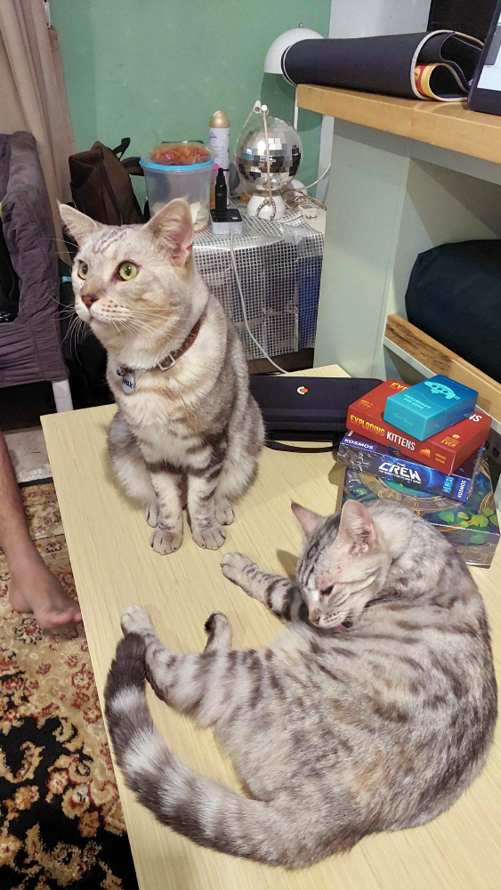
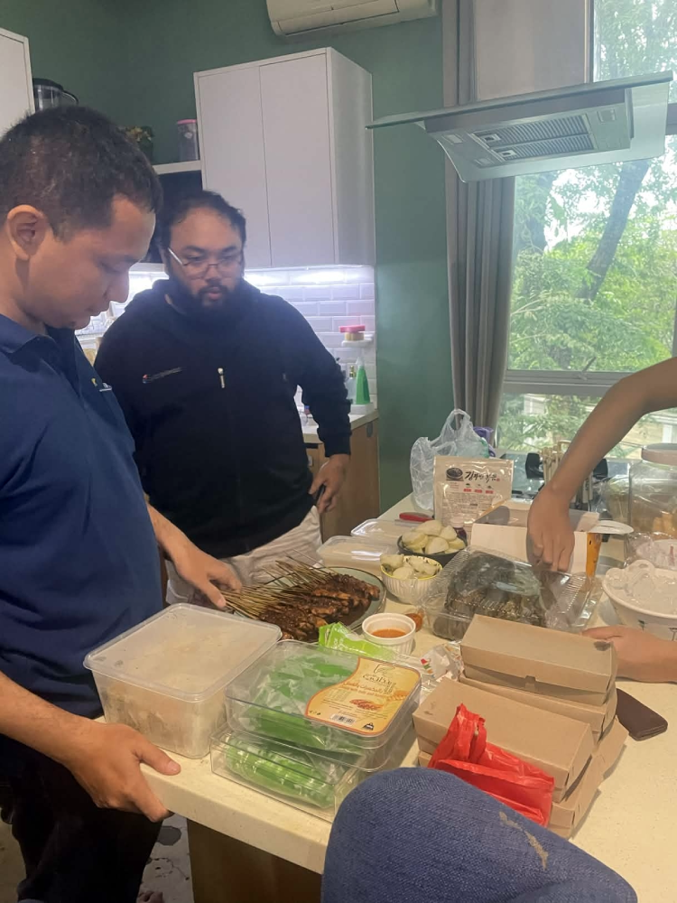
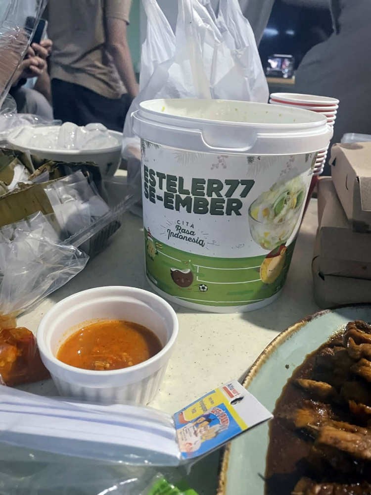
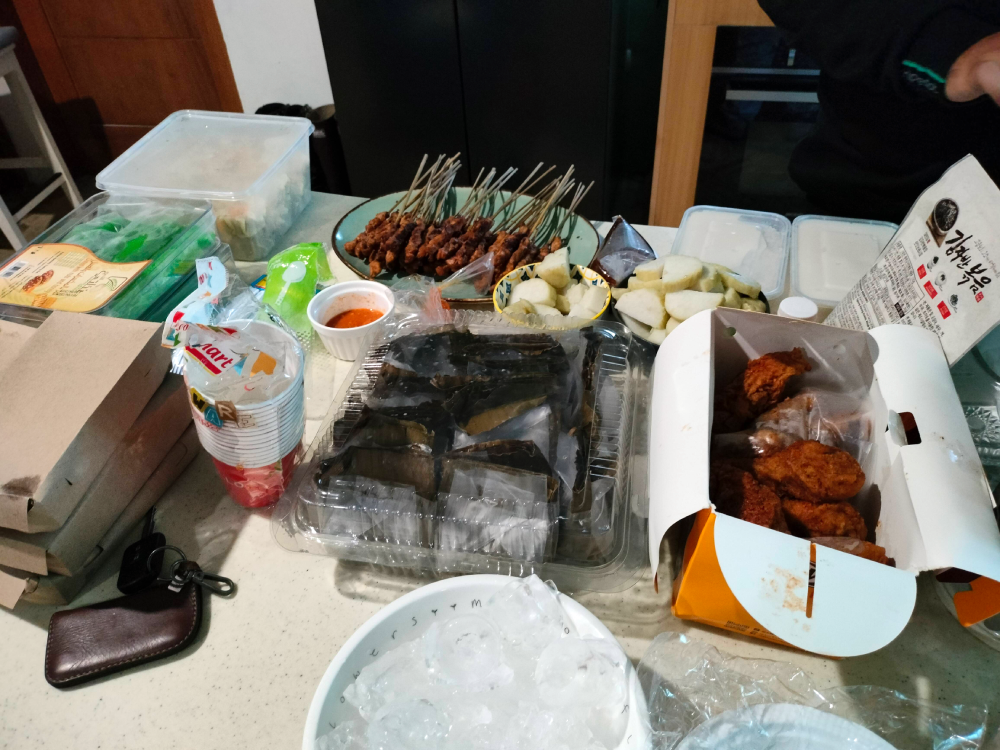
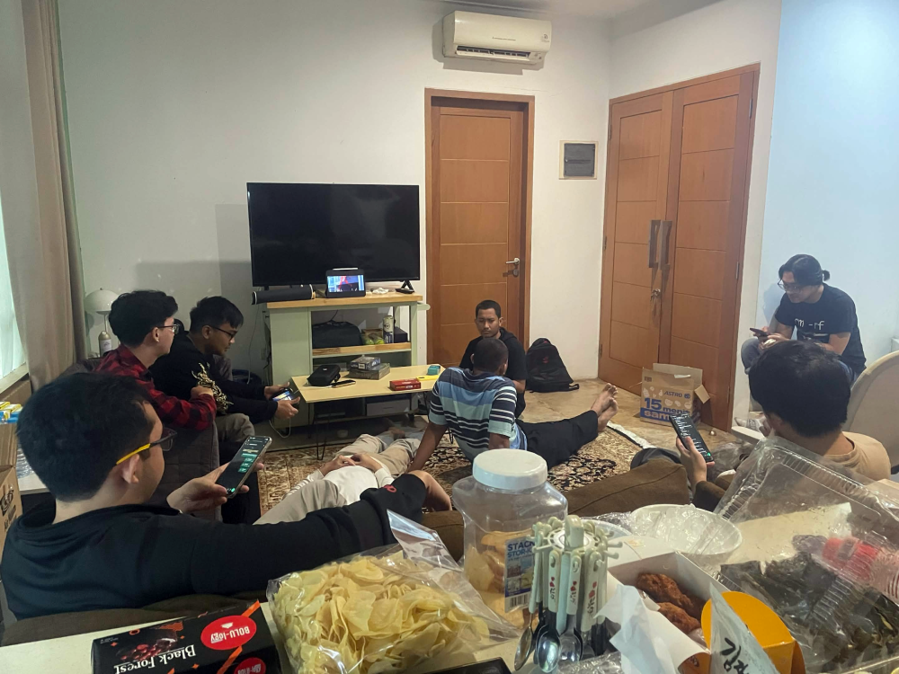
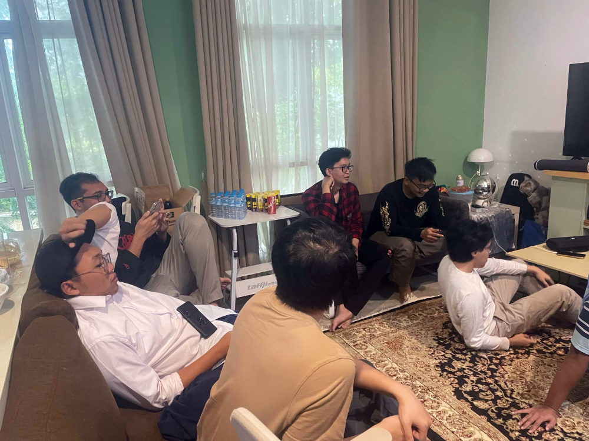
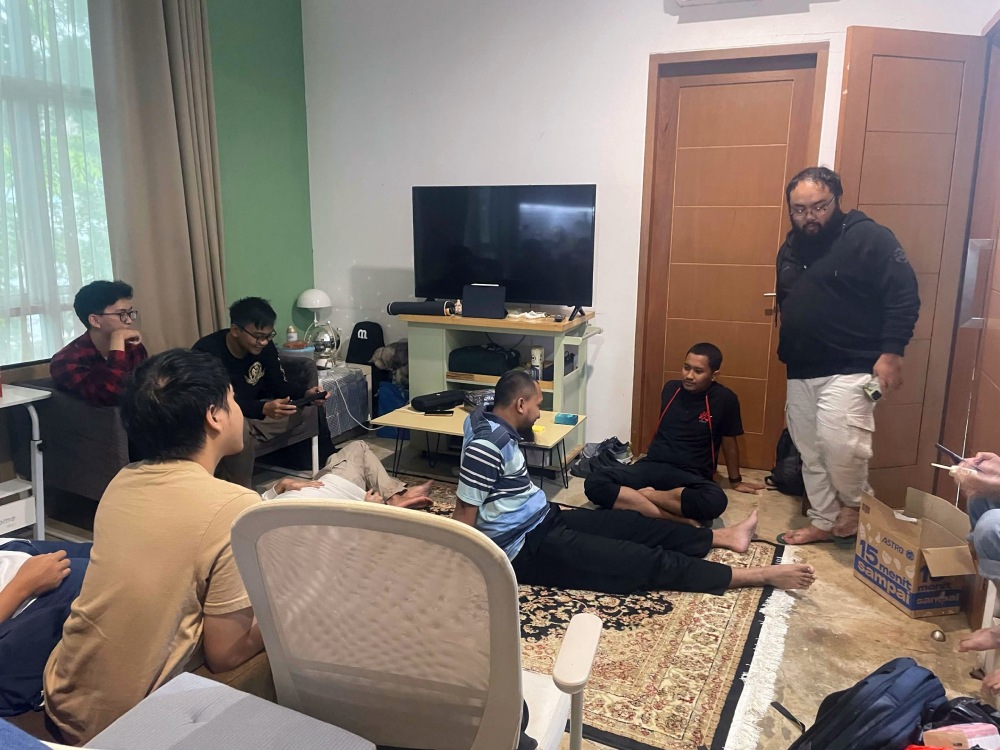
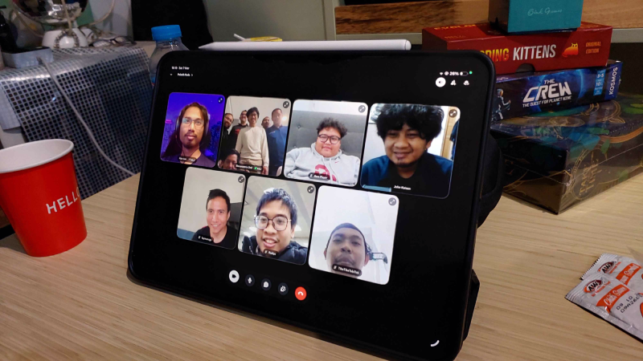
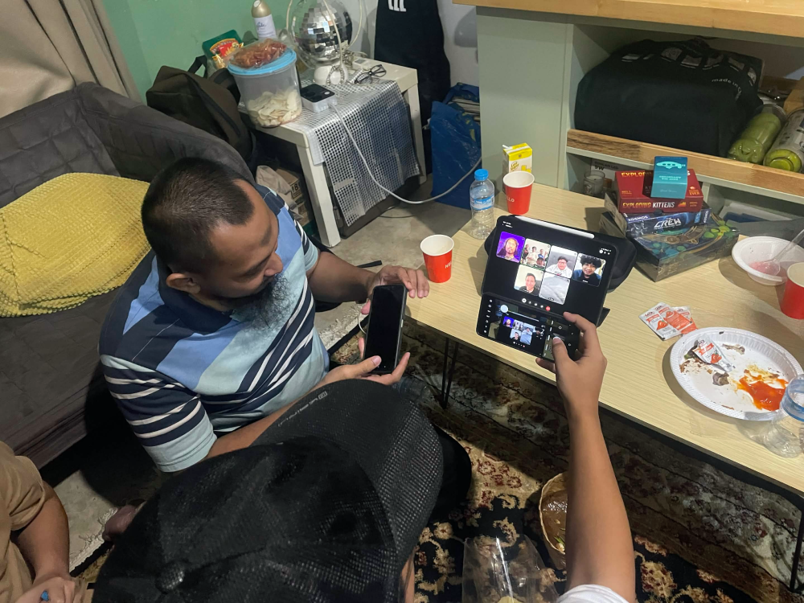
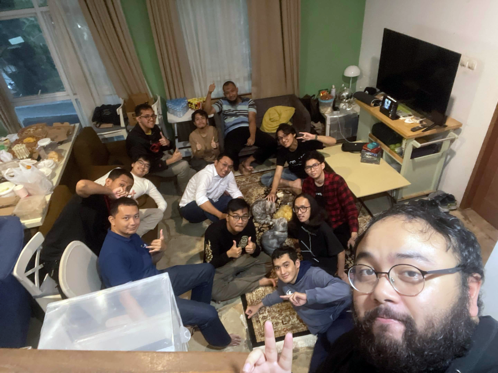

---
# Copyright (c) Gagah Pangeran Rosfatiputra (GPR) <gpr@gagahpangeran.com>.
# Licensed under CC-BY-NC 4.0.
# Read the LICENSE file inside the 'content' directory for full license text.

title: "Bukber 2026"
date: "2026-03-14T22:30:00+07:00"
featuredImage: "./img/bukber-2026.png"
tags: ["Story", "Bukber", "Ramadhan", "Puasa"]
lang: "id"
---

Sabtu pekan lalu acara tahunan bukber akhirnya kembali tiba. Seperti yang gue
bilang di [tahun sebelumnya][bukber2025], tahun ini kami gak bisa bukber di
rumahnya seperti tahun-tahun sebelumnya.

<!-- excerpt -->

Karena Dean lagi kuliah di US, jadinya tahun ini kami gak bisa bukber di
rumahnya. Tadinya kami berencana untuk tetap bukber di rumah Dean meskipun
dianya gak ikut. Tapi akhirnya gak jadi karena kami bingung gimana caranya
ngomong ke orang rumahnya Dean.

Tahun ini akhirnya Bimo kembali ikut dan gue berangkat bareng numpang mobil dia.
Gue, Dafa, Reyhan, dan Bimo berangkat sekitar jam 4 sore.

Karena kami gak bisa bukber di rumah Dean tahun ini, akhirnya kami memutuskan
untuk bukber di rumahnya Kani. Rombongan gue nyampe rumah Kani sekitar jam 5
sore.

Bukber kali ini yang datang ada Kani sebagai tuan rumah, gue, Bimo, Dafa,
Reyhan, Ervan, Sayid, Ariq, Gio, Satrio, Tan, FwP, dan Nafis.

Pas rombongan gue nyampe, hampir semuanya udah di sana. Tinggal FwP sama Nafis
yang belum datang.

Oh ya, di rumah Kani juga ada dua kucing ini ikutan bukber. Namanya Max sama
~~Verstappen~~ (yang satu lagi gue lupa namanya).

Sama seperti tahun sebelumnya, setiap orang bawa satu makanan buat buka puasa.
Sambil nunggu buka puasa, kami nyiapin makanan sama minuman yang dibawa
masing-masing.

Gak lama kemudian, FwP sama Nafis akhirnya datang. Suasananya sangat rame dan
pada ngobrol sambil ngabuburit.

Pas buka puasa, kami juga coba video call lewat discord buat orang-orang jauh
yang gak bisa datang. Ada Dean yang join dari California, Sage join dari
Bristol, Abed join dari Jepang, Dipsi join dari Korsel, Sidiq join dari Soppeng,
dan Aab join dari Cimahi. Buka puasa kali ini memiliki nuansa acara
internasional.

Kemudian sekitar jam 8 malam kami semua bubar dan mulai pulang.

Berikut foto bareng yang diambil sebelum berbuka puasa.

Udah itu aja cerita buat bukber tahun ini. Semoga tahun depan bisa kumpul bareng
lagi dan orangnya lebih banyak yang bisa ikut.

[bukber2025]: /blog/bukber-2025/
